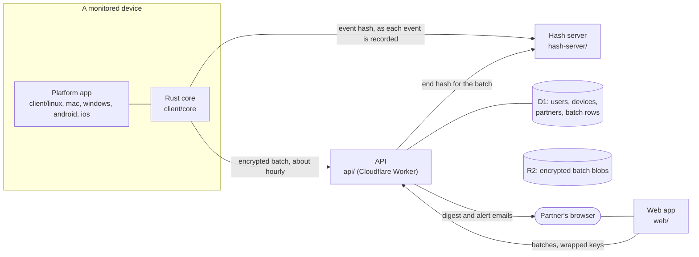

# How Virtue works

Virtue is a free accountability tool. A person installs it on their own phones and computers. It
takes screenshots at random times, scores each one for concerning content on the device, blurs it
and blacks out text, and uploads the screenshots encrypted so that only the people they chose can
read them. Those people are their **partners**. Partners get a daily or weekly email and read the
person's logs in the web app. The aim is to start conversations and give motivation to avoid
pornography, not to catch people out.

This page explains how the parts fit together. Each part's exact behavior is in its `SPEC.md`.

## Goals and non-goals

These describe the project as it stands now. Judge changes and reviews against them, and
change them here when the project's direction changes.

### Goals

- **Monitor, don't block.** Record everything on the device that we reasonably can, and never
  stop the person from doing something on their own device. Virtue reports; the person and
  their partners decide what to do about it.
- **Accountability between willing adults.** The person chose to install Virtue and chose their
  partners. The app is a tool to support that relationship and start conversations, not a
  foolproof guarantee.
- **Resist tampering by people who aren't computer experts.** Stopping, signing out, pausing or
  revoking a permission should be reported to partners. Some things can't be reliably
  detected, uninstalling above all, so the design makes them visible instead: every sign-in
  registers a new device (CORE-008, decision
  [0004](decisions/0004-every-sign-in-is-a-new-device.md)), so partners see an old device go quiet and a new one
  appear, rather than a seamless continuation.
- **Respect the monitored person's privacy.** Screenshots are blurred and their text blacked
  out on the device, and the servers can't read anything (decision
  [0001](decisions/0001-servers-never-read-content.md)). Privacy and seeing enough to be
  useful pull against each other. There is no fixed rule for which wins, so weigh both and
  say which way a change leans.
- **Stay free to use, and cheap enough to run for free.** Hosting cost is a real input to
  design decisions, which is one reason the servers run on Cloudflare Workers, D1 and R2.

### Non-goals

- **Blocking or filtering.** Not wrong in principle, but too complicated to take on, so
  decisions shouldn't be shaped by it. The help pages may point people to tools they can use
  to restrict themselves.
- **Parental controls**, or monitoring anyone who hasn't agreed to it. The app is for adults.
- **Defeating expert tampering.** Dual booting, building a custom binary, editing the client's
  state files or similar are out of scope for now. `client/core/tampering.md` lists what the
  current model can't catch.
- **Rare edge cases.** Handle an edge case, including an old OS version or an unusual
  platform setup, only if it is likely to significantly affect more than 1% of users. Below
  that, prefer simple code and accept the gap. Exceptions that always matter, however rare:
  losing or corrupting recorded data, and anything that would break the encryption or the
  hash chain.

### In review

- A change that blocks, delays or restricts something the user is doing needs a very good
  reason; blocking features are out of scope.
- Don't ask for protection against expert tampering, or for handling an edge case few users
  will hit. Flag added complexity that exists only for those.
- Do flag anything that lets an ordinary user turn monitoring off, or hide activity, without
  their partners being able to tell.
- Do flag anything that could lose recorded data, weaken the encryption or the hash chain, or
  let the servers see content.
- Note privacy costs and running costs when a change adds them.

## The parts

| Part         | What it does                                                                                        | Spec                   |
| ------------ | --------------------------------------------------------------------------------------------------- | ---------------------- |
| Client apps  | Capture screenshots and OS signals, sign in, show status. One per platform.                         | `client/SPEC.md`       |
| Rust core    | Everything shared: scheduling, scoring, redaction, tamper detection, encryption, upload.            | `client/core/SPEC.md`  |
| API          | Accounts, devices, partners, storing batches, emails. Never sees what a batch contains.             | `api/SPEC.md`          |
| Hash server  | Keeps a running hash of every event each device records, so a batch can't be edited after the fact. | `hash-server/SPEC.md`  |
| Web app      | Where people manage partners and devices, and where partners read logs and reports.                 | `web/SPEC.md`          |
| Batch format | The bytes of an encrypted batch, shared by the Rust producer and the TypeScript consumer.           | `batch-format/SPEC.md` |
| Landing site | The marketing site, downloads and help pages (`landing/`).                                          | none                   |
| Donations    | A separate Worker for Stripe donations and the newsletter (`api-donate/`).                          | `api-donate/SPEC.md`   |

## How a screenshot reaches a partner

1. **Capture.** The core picks capture times at random, so every second is equally likely
   (CORE-003). It skips the capture when the screen is locked or hasn't changed.
2. **Process on the device.** The screenshot is scored for concerning content (the **risk**, or
   concern score), text is detected and blacked out, and the image is blurred and shrunk. The
   original never leaves the device.
3. **Hash.** Each event's bytes are hashed and the hash is sent to the hash server right away,
   which folds it into a running hash for that device (BATCH-006, HASH-006).
4. **Batch and encrypt.** About once an hour the core packs the waiting events into a **batch**,
   encrypts it with a fresh key, and wraps that key once for each partner (and the owner) with
   their public key (BATCH-002, BATCH-005). High-risk events go out at once instead of waiting.
5. **Upload.** The API stores the encrypted blob in R2 and records the hash server's running
   hash as the batch's **end hash**, then resets it (API-038). It counts high-risk events from
   metadata the device sends alongside, so it can email alerts without decrypting anything.
6. **Read.** A partner's browser fetches the batch, unwraps its key with their private key,
   decrypts it, and recomputes the hash chain. If it doesn't match the end hash, every event in
   the batch is marked unverified (WEB-016).

## Keys

Every account has a key pair. The private key is encrypted in the browser with a key derived
from the password and stored on the server in that form only; the password itself is never
sent, only a value derived from it ([`accounts-and-keys.md`](accounts-and-keys.md) follows it
through every step). A device learns the public keys
it must encrypt for, its **wrapping keys**, from the API's device settings. So adding or
removing a partner changes who can read batches uploaded from then on, not earlier ones. A
forgotten password can't recover old logs, because nothing on the server can decrypt them.

## Tamper detection

The core expects to wake up at the times it scheduled. If it wakes up late, the time it was
gone is counted, and too much missed time raises an alert, excused around sign-in, sign-out and
sleep (CORE-002, `client/core/tampering.md`). Stopping monitoring from the app sends an alert
too (CLIENT-011), and repeated capture failures raise one (CORE-006). Uninstalling sends
nothing, so a device that stops reporting shows as offline to its partners, and their digest
names it as having no logs.

## Glossary

| Term                 | Meaning                                                                                                      |
| -------------------- | ------------------------------------------------------------------------------------------------------------ |
| Monitored person     | Someone who has installed Virtue on their own devices.                                                       |
| Partner              | Someone a monitored person invited, who can read their logs. "You monitor" and "Monitor you" in the web app. |
| Device               | One install of a client app, registered to one account.                                                      |
| Event / log          | One thing a device recorded: a screenshot, a missed screenshot, a sign-in, a tamper alert, and so on.        |
| Risk / concern score | 0 to 1, from the on-device classifier. The web app shows it as Low, Medium, High or Alert (WEB-024).         |
| Batch                | A group of events from one device, encrypted together (BATCH-001).                                           |
| Access keys          | A batch's key, wrapped once per reader (BATCH-005).                                                          |
| Wrapping keys        | The public keys a device encrypts batch keys for (API device settings).                                      |
| End hash             | The hash chain state for a batch, kept by the hash server, used to verify it (BATCH-006).                    |
| Heartbeat            | A daily event that shows a device is still running (CORE-006).                                               |
| Late wakeup          | The core woke up later than it scheduled; the basis of tamper detection (CORE-002).                          |
| Daemon               | The core's monitoring loop, whatever process it runs in.                                                     |

## Where to go next

- [`docs/README.md`](README.md): every doc and what it covers.
- [`docs/development.md`](development.md): setting up a machine and running the stack.
- [`docs/accounts-and-keys.md`](accounts-and-keys.md): signup, sign-in, partners and passwords,
  and what each does to the keys.
- [`docs/releasing.md`](releasing.md): how a change reaches the servers and people's devices.
- [`client/README.md`](../client/README.md): the platform apps.
- [`TESTING.md`](../TESTING.md): how specs and tests connect.
