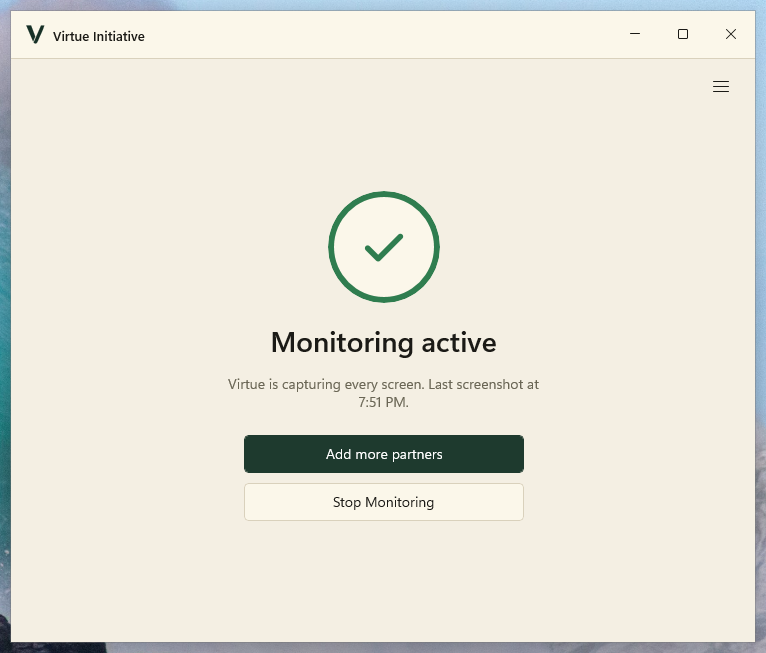
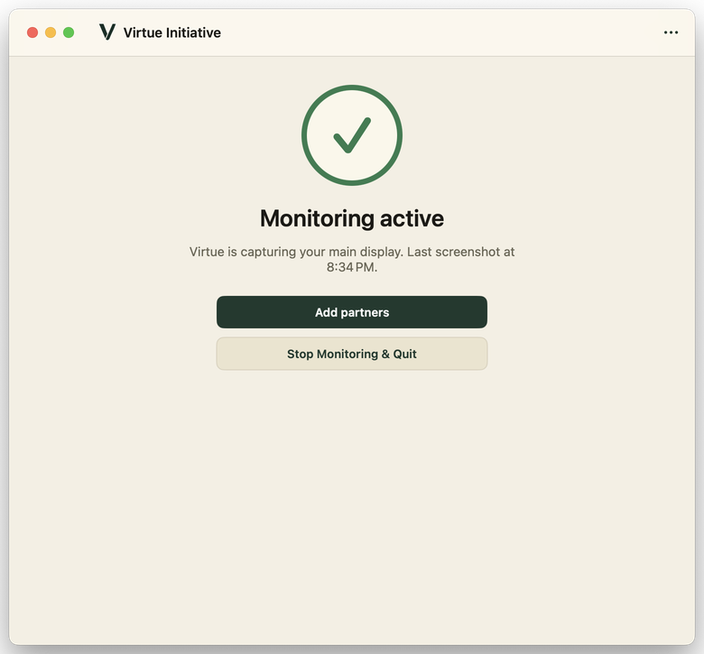
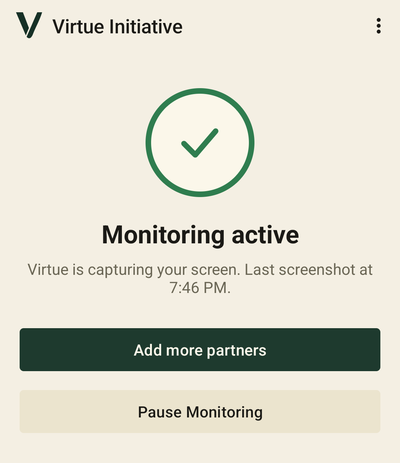
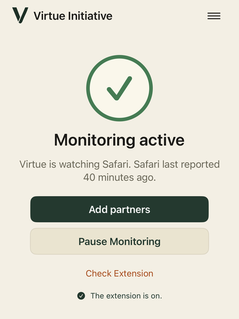
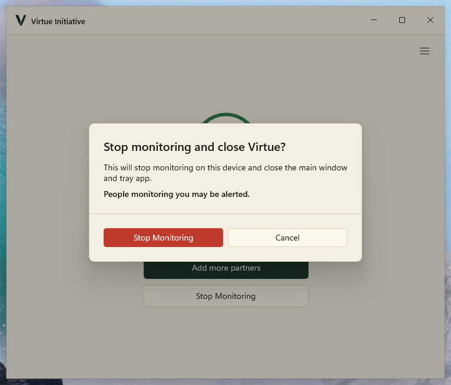
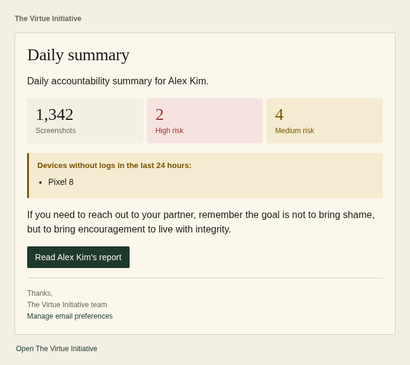

Version 0.1.9 of Virtue is out. The biggest change in this release is a
redesign of the apps on every platform: Windows, Mac, Android and iPhone. We
also cleaned up the email reports partners get. Thank you to everyone who has
installed the app and sent us feedback so far!

## One thing at a time

The old apps showed a lot at once: status text, settings, buttons for things
most people never need. The new design shows one thing at a time, depending on
what you need to do right now. If you are signed out, you see the sign in form.
If monitoring is running, you see a green check and when the last screenshot was
taken.

Everything else (status details, what Virtue monitors, reporting an issue,
checking for updates and signing out) is in a menu in the top corner.

The phone apps got the same treatment. Here are Android and iPhone:

On Android, the setup guide now fits on one page. The app also no longer asks
for notification and battery permissions as soon as you open it. Instead, the
first setup step explains why it needs them and lets you allow them there.

If you stop monitoring, the app now clearly warns you before it does anything.
The safe choice (Cancel) is selected by default, so you can't stop it by
accident.

## Easier to read email reports

If you are someone's accountability partner, you get a regular email report.
These used to have too much information and not enough structure. Each report
now shows the number of screenshots, high risk and medium risk at the top, and
only highlights the risk counts when there is something to look at. Devices
that have not sent anything are grouped in one place, and if you are a partner
for more than one person, each person gets their own section.

## Behind the scenes

We also spent a lot of time on things you won't see. We fixed a few privacy
issues in how login and password reset work, and added a large set of automated
tests so we can make changes without breaking things. We are also testing a new
way of checking screenshots that looks at each image on the screen separately.
It is not turned on yet, but early results catch far more inappropriate content
without flagging ordinary pages.

## How to update

Most apps update themselves. On Windows and Mac, you can also open the menu and
choose "Check for Updates". If you haven't installed Virtue yet, you can
[sign up here](https://app.virtueinitiative.org/signup).

As always, if you have questions, ideas or run into a problem, write to us at
[help@virtueinitiative.org](mailto:help@virtueinitiative.org).
