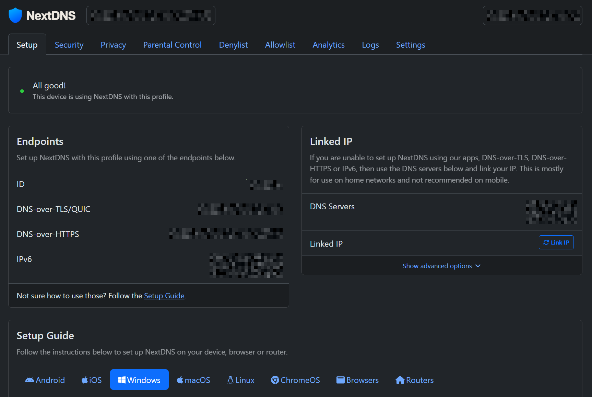
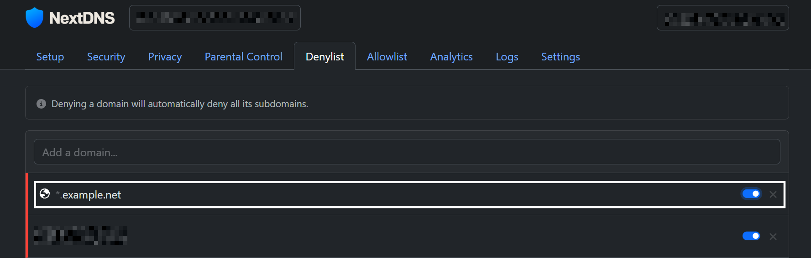
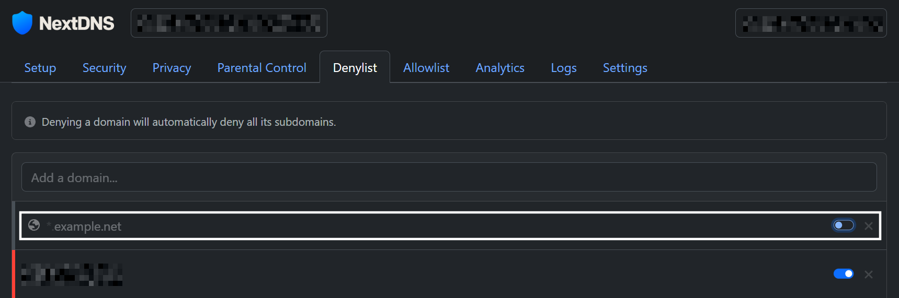

# DNS filter check

If you use a DNS filter such as NextDNS, Virtue can check that it stays on. You
add a domain to your filter's block list and enter the same domain in Virtue.
Your devices then look it up at random times, at least once an hour. If the
filter stops blocking it, your partners get an alert.

Virtue only reports what it finds. It never blocks or changes your DNS traffic.

## Why use a DNS filter

A DNS filter is a first layer of protection for you and the people you love. It
stops most pornographic sites from loading before you see them. It does not
catch everything, but it blocks a large part. It is a preventive measure, and it
helps you avoid temptation in the first place.

## Choose a DNS filter

You can use a hosted service or run one yourself.

- [NextDNS](https://nextdns.io) is a hosted service. Its **Setup** tab has a
  guide for every kind of device.
- [AdGuard Home](https://adguard.com/en/adguard-home/overview.html) and
  [Pi-hole](https://pi-hole.net) run on your own server or home network.

### Recommended settings in NextDNS

Open the **Parental Control** tab and turn on these settings:

- **Porn** under **Categories** blocks known pornographic sites.
- **SafeSearch** hides explicit results in search engines.
- **YouTube Restricted Mode** hides mature videos on YouTube.
- **Block Bypass Methods** blocks VPNs, proxies and other ways around the
  filter.

The blocklists on the **Privacy** tab block ads and trackers, not adult content.

### Recommended lists for AdGuard Home and Pi-hole

Add a list that blocks adult content, such as the NSFW list from
[HaGeZi](https://github.com/hagezi/dns-blocklists) or from
[OISD](https://oisd.nl). The community maintains both lists and updates them
regularly.

## Check that your device uses the filter

The steps below use NextDNS as an example. Other DNS filters work the same way
as long as they let you block a single domain.

Set up your DNS filter on every device you want checked. In NextDNS, open the
**Setup** tab on that device. It shows **All good!** when the device uses your
profile.

## Block a check domain

Pick a domain you never need, such as `example.net`. In NextDNS, open the
**Denylist** tab, type the domain into **Add a domain…** and press Enter. Make
sure the switch next to it is on.

## Turn on the check in Virtue

1. Open **Settings** and find **DNS filter check**.
2. Turn on **Check my DNS filter**.
3. Enter the domain in **DNS check domain** and click **Save**.

The domain applies to all your devices. Each device checks it as soon as it
picks up the new setting. After that, each device waits a random time before
the next check: 20 minutes on average, never less than 1 minute and never more
than 60. Because the time changes after every check, there is no safe window to
plan around.

## What your partners see

- **DNS Filter Off** appears in your logs when a device can look up the domain
  normally. Your partners get an email right away.
- **DNS Filter On** appears when the domain is blocked again. No email is sent.
- Your partners get an email right away when you turn the check off, change the
  domain, or turn the check off for one device.

A device that is offline reports nothing. It checks again 10 minutes later.

See [Log types](/help/web/log-types) for every log entry.

## Turn the check off for one device

Some devices use their own DNS, such as a work laptop. Open **Devices**, click
**Edit** on that device and turn off **Check the DNS filter on this device**.
Your partners are notified.

## Test the alert

Tell your partner before you test. In NextDNS, turn off the switch next to your
check domain on the **Denylist** tab.

Within an hour, your device logs **DNS Filter Off** and your partners get an
email. Turn the switch back on when you are done.
